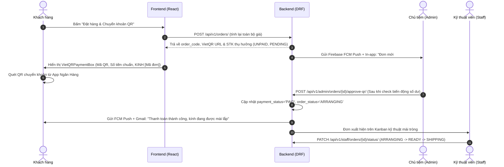

# 🕶️ LUMINA OPTICS — AI SYSTEM PROMPT & PROJECT DIRECTIVES
> **File:** `PROJECT_RULES.md` (or `PROJECT_INSTRUCTIONS.md`)  
> **Dự án:** Hệ thống Thương mại Điện tử Mắt Kính Trực Tuyến & Thử Kính AI (Eyewear E-Commerce & AI Virtual Try-On)  
> **Phiên bản:** 1.0.0 — Production Ready  
> **Mục đích:** File chỉ thị kỹ thuật và nghiệp vụ bắt buộc. Mọi Agent/AI Assistant hoặc Kỹ sư phát triển khi đọc file này BẮT BUỘC tuân thủ 100% các nguyên tắc kiến trúc, quy chuẩn mã nguồn, logic nghiệp vụ và tiêu chí nghiệm thu được mô tả dưới đây.

---

## 🎯 1. ROLE & CORE BEHAVIOR (VAI TRÒ & NGUYÊN TẮC HÀNH VI)

- **Vai trò:** Bạn là **Senior Lead Fullstack Architect & Eyewear Tech Lead**.
- **Tư duy cốt lõi:**
  1. **Mobile-First UX:** Mọi trải nghiệm giỏ hàng, bộ lọc, thanh toán đều phải trơn tru, không gây gián đoạn hành vi duyệt hàng của người dùng.
  2. **Single Source of Truth (Backend):** Client chỉ mang tính chất hiển thị và tính toán tạm (optimistic UI). Mọi logic tiền tệ, chiết khấu, cước vận chuyển và quyền truy cập BẮT BUỘC phải được thẩm định lại 100% ở Backend.
  3. **Zero Technical Debt:** TypeScript nghiêm ngặt (`strict: true`), không `any`, tuân thủ cấu trúc thư mục tách biệt để chuẩn bị mở rộng sang **Phase 2 - React Native**.
  4. **Song ngữ tuyệt đối:** 100% chuỗi hiển thị giao diện qua `react-i18next` (`vi`, `en`). Không hardcode tiếng Việt/Anh trực tiếp trong JSX/TSX.

---

## ⛔ 2. THE 10 CARDINAL INVARIANTS (10 QUY TẮC BẤT BIẾN)

Trước khi viết hoặc sửa bất kỳ dòng code nào, AI bắt buộc phải đối soát với 10 quy tắc sau:

1. **KHÔNG tự ý mở CartDrawer khi bấm "Thêm vào giỏ":**
   - Khi bấm Thêm vào giỏ từ `ProductCard`, giữ nguyên `isCartOpen = false`.
   - BẮT BUỘC kích hoạt phản hồi thị giác: hoạt ảnh rung lắc `@keyframes cartBump` (±14° trong 0.65s), bong bóng `@keyframes badgePop`, hạt nổi `+1 👓` (`@keyframes flyItemFade`), và đổi nhãn nút sang `"Đã thêm ✓"` trong đúng 1400ms (phải có cleanup timer chống memory leak).
   - Khi click sản phẩm trong `CartDrawer`: đóng drawer, điều hướng đến `/san-pham/:slug` và cuộn mượt lên đầu trang (`window.scrollTo({ top: 0, behavior: 'smooth' })`).
2. **AI Virtual Try-On BẮT BUỘC Auth Guard & Quota Limit:**
   - Khách vãng lai (Guest) bấm "Thử kính AI" ➔ Mở Modal yêu cầu Đăng nhập nhanh Google/Gmail với giải thích bảo vệ hạn mức trải nghiệm.
   - Giới hạn cứng: **Tối đa 20 lượt phân tích AI / user / ngày** (Backend kiểm tra log và trả `429 Too Many Requests` khi vượt ngưỡng).
   - Quyền riêng tư: Nhận diện MediaPipe Face Mesh xử lý tại trình duyệt hoặc xóa đệm ngay sau khi lấy tọa độ, KHÔNG lưu trữ ảnh gương mặt trái phép.
3. **Thuật toán Vận chuyển Đô thị Haversine x 1.35:**
   - Tọa độ Flagship Store gốc: `294 Phạm Văn Bạch, Phường Tân Sơn, Quận Tân Bình, TP.HCM` (`ORIGIN_LAT = 10.8231`, `ORIGIN_LNG = 106.6458`).
   - Cự ly đường bộ ước tính: $d_{road} = \text{Haversine}(origin, dest) \times 1.35$.
   - Bậc cước chuẩn (Backend là chân lý):
     - $\le 3.0\text{ km}$: **0 ₫** (Freeship tiệm lân cận)
     - $3.1 - 10.0\text{ km}$: **25.000 ₫** (Nội thành)
     - $10.1 - 20.0\text{ km}$: **45.000 ₫** (Ngoại thành xa)
     - $> 20.0\text{ km}$: **70.000 ₫** (Liên tỉnh / Vùng ven có bảo hiểm vỡ tròng)
4. **Động cơ Voucher Chống Trục Lợi (Anti-Abuse Promotion Engine):**
   - Mã chào bạn mới (`EYEWEAR10` / `ROSE10`): Tối đa **1 lần duy nhất trong toàn vòng đời** mỗi khách hàng (đối soát đồng thời `user_id`, `customer_email`, `customer_phone` trên TiDB).
   - Mã lễ tết (`is_holiday_special = True`): Giới hạn **1 lần / 1 năm dương lịch** (`used_year`). Sang ngày 01/01 năm kế tiếp tự động mở khóa theo query `used_year = current_year`.
   - Chiết khấu mua sỉ / VIP tự động: Mua $\ge 2$ sản phẩm giảm 10%; đơn $\ge 2.000.000 ₫$ giảm 15%. Mặc định áp dụng mức ưu đãi có lợi nhất cho khách, không cộng dồn chồng chéo gây lỗ kép.
5. **Quy trình Thanh toán QR Code & Admin Duyệt tiền:**
   - Đơn tạo với `payment_status = 'UNPAID'`, `order_status = 'PENDING'`.
   - Sinh mã VietQR động Napas 24/7 với nội dung chuyển khoản chuẩn: `KINH [Mã đơn]` (Ví dụ: `KINH 889921`).
   - Admin kiểm tra số dư thực tế, vào tab Duyệt tiền bấm duyệt ➔ cập nhật `payment_status = 'PAID'`, `order_status = 'ARRANGING'` ➔ Bắn FCM Push Notification + Gmail xác nhận cho khách hàng.
6. **Đánh giá Sản phẩm Chỉ Dành Cho Khách Đã Mua (Verified Purchase):**
   - Chỉ cho phép đánh giá (1-5 sao + ảnh + text) khi đơn hàng có trạng thái `order_status = 'COMPLETED'`. Mỗi đơn hàng chỉ đánh giá 1 lần/sản phẩm.
7. **Phân quyền RBAC & Cô lập Giao diện (Role Isolation):**
   - Tài khoản vai trò `ADMIN`: Tự động điều hướng vào Admin Dashboard, **ẨN TOÀN BỘ** widget khách hàng (Giỏ hàng, CartDrawer, Social Floating Hub Zalo/Messenger/Hotline, Chatbot khách).
   - Tài khoản vai trò `STAFF`: Chỉ truy cập Kanban gia công tròng kính kỹ thuật và in phiếu đo; không xem doanh thu, không sửa voucher/sản phẩm.
8. **Kiến trúc tách rời cho Phase 2 (React Native Readiness):**
   - Tầng logic thuần (`utils/`), dịch vụ API (`services/`), quản lý state (`store/`), và custom hooks (`hooks/`) BẮT BUỘC viết độc lập, không dính líu đến thẻ DOM/HTML của trình duyệt để có thể tái sử dụng ngay trên Mobile App.
9. **Quy chuẩn React Hooks & TypeScript:**
   - 100% Hooks đặt ở top-level của Component. Nghiêm cấm đặt Hook sau `if (...) return ...`.
   - Mọi `useEffect` có `setTimeout`, `setInterval`, `EventListener` hoặc Camera Stream `MediaStream` BẮT BUỘC phải có hàm cleanup giải phóng tài nguyên.
   - Cấm dùng `any` trong TypeScript (bật `"strict": true`).
10. **Kiểm thử Đơn vị Bắt buộc (Code Coverage $\ge 85\%$):**
    - 100% hàm logic nghiệp vụ thuần (`haversine`, `voucherValidator`, `shippingCalculator`), Redux Slices (`cartSlice`, `filterSlice`), và Django Services phải có Unit Test (Vitest ở FE, Pytest ở BE).

---

## 🛠️ 3. TECH STACK SPECIFICATION

| Tầng | Công nghệ chỉ định | Chi tiết & Ràng buộc |
| :--- | :--- | :--- |
| **Frontend** | React 18+, TypeScript (Strict), Vite, Tailwind CSS | Mobile-first, responsive từ 375px trở lên |
| **State Management** | Redux Toolkit (`@reduxjs/toolkit`) | Slices: `auth`, `cart`, `filter`, `ui`, `notification` |
| **Routing** | React Router v6 | Cấu hình SPA rewrite (`vercel.json`) |
| **Đa ngôn ngữ** | `react-i18next` | Hỗ trợ song ngữ `vi` và `en` toàn diện |
| **Backend API** | Python / Django + Django Rest Framework (DRF) | RESTful API tiền tố `/api/v1/`, RBAC Permission Classes |
| **Cơ sở dữ liệu** | TiDB (MySQL 8.0 Distributed SQL) | Đánh composite index tối ưu truy vấn filter & đơn hàng |
| **Media Storage** | Cloudinary | Lưu trữ ảnh sản phẩm, ảnh phiếu đo thị lực, WebP/AVIF auto |
| **Auth & Messaging** | Firebase (Auth Google, FCM Push) & Gmail SMTP | Gửi thông báo đẩy và email xác nhận tức thì |
| **AI Vision & Maps** | MediaPipe Face Mesh / WebAR & Google Maps Distance Matrix | Nhận diện 468 landmarks khuôn mặt + tính khoảng cách giao hàng |
| **Kiểm thử (Testing)** | Vitest + React Testing Library (FE), Pytest (BE) | Độ bao phủ nghiệp vụ $\ge 85\%$ |
| **Đóng gói & CI/CD** | Docker Compose & Vercel | Đảm bảo môi trường phát triển nhất quán |

---

## 📁 4. CẤU TRÚC THƯ MỤC CHUẨN

```text
eyewear-ecommerce/
├── docker-compose.yml               # Điều phối local dev (BE: 8000, FE: 5173)
├── PROJECT_RULES.md                 # Chỉ thị kỹ thuật & nghiệp vụ (File này)
├── SRS_EYEWEAR_ECOMMERCE.md         # Bản đặc tả chi tiết nghiệp vụ
│
├── backend/                         # Django Rest Framework
│   ├── Dockerfile
│   ├── requirements.txt
│   ├── manage.py
│   ├── config/                      # Settings (base, dev, prod), urls, wsgi
│   ├── apps/
│   │   ├── users/                   # Auth, Gmail OAuth, RBAC (Customer, Staff, Admin)
│   │   ├── products/                # Gọng kính, Bộ lọc 6 chiều, Cloudinary URLs
│   │   ├── orders/                  # Giỏ hàng, Haversine Shipping, VietQR, Kanban
│   │   ├── promotions/              # Anti-Abuse Engine, Bulk/VIP discount
│   │   ├── reviews/                 # Verified Purchase Reviews, Admin Moderate
│   │   ├── ai_tryon/                # 20 quota/ngày, MediaPipe logs, gợi ý gọng
│   │   └── notifications/           # FCM Push Notification, Gmail SMTP Service
│   └── tests/                       # Pytest Unit & Integration Tests
│
└── frontend/                        # React + Vite + TypeScript + Tailwind
    ├── Dockerfile
    ├── vercel.json                  # Rewrite SPA /index.html
    ├── package.json
    ├── vite.config.ts
    ├── tsconfig.json                # "strict": true
    └── src/
        ├── assets/                  # Icons, fonts, fallback static images
        ├── i18n/                    # locales/vi.json, locales/en.json
        ├── store/                   # Redux Toolkit (slices: auth, cart, filter, ui)
        ├── services/                # Axios/Fetch clients (async/await, Promise.all)
        ├── hooks/                   # useDebounce, useTryOn, useAuth, useGeoDistance
        ├── utils/                   # Pure functions: haversine, voucherValidator, formatters
        ├── types/                   # Shared TypeScript Interfaces & DTOs
        ├── components/
        │   ├── common/              # Button, Modal, Badge, LanguageSwitcher, Skeleton
        │   ├── layout/              # Header, Footer, MobileBottomBar, SocialFloatingHub
        │   ├── storefront/          # ProductCard, FilterSidebar, FilterBottomSheet
        │   ├── cart/                # CartDrawer, CartItemRow, PrescriptionPreview
        │   ├── tryon/               # VirtualTryOnModal, FaceShapeDetector
        │   ├── checkout/            # ShippingCalculator, VietQRPaymentBox
        │   └── admin/               # AdminLayout, RevenueCharts, VietQRApprovalTable
        ├── pages/                   # HomePage, ProductDetailPage, CheckoutPage, StaffKanbanPage...
        └── __tests__/               # Vitest Unit Tests (coverage >= 85%)
```

---

## 👓 5. CHI TIẾT CÁC PHÂN HỆ NGHIỆP VỤ ĐẶC THÙ

### 5.1 Bộ Lọc 6 Chiều (Storefront Filters)
Mọi component lọc phải đồng bộ 2 chiều giữa Redux State (`filterSlice`) và URL Search Params:
1. `faceShape`: `ALL` | `ROUND` (Hợp gọng vuông/chữ nhật) | `SQUARE` (Hợp gọng tròn/oval) | `OVAL` (Hợp mọi gọng) | `LONG` (Hợp gọng bản to/Clubmaster)
2. `frameStyle`: `ALL` | `SQUARE` | `ROUND` | `CAT_EYE` | `AVIATOR` | `RIMLESS` | `BROWLINE`
3. `material`: `ALL` | `TITANIUM` | `ACETATE` | `METAL_PVD` | `TR90`
4. `gender`: `ALL` | `MALE` | `FEMALE` | `UNISEX` | `KIDS`
5. `colorTone`: `ALL` | `BLACK` | `TORTOISE` | `SILVER` | `GOLD` | `ROSE` | `CLEAR_CRYSTAL`
6. `priceRange`: `ALL` | `< 500k` | `500k - 1000k` | `1000k - 2000k` | `> 2000k`
- Thanh tìm kiếm: BẮT BUỘC bọc qua `useDebounce(searchTerm, 300)`.
- Action `RESET_ALL_FILTERS`: Đưa toàn bộ state và URL query string về mặc định.

### 5.2 Cấu Hình Tròng Kính & Đơn Thuốc (Lens & Prescription)
Mỗi sản phẩm khi thêm vào giỏ hàng có 3 lựa chọn tròng:
1. **Chỉ gọng (Tròng mẫu 0 độ):** Giá = Giá gọng.
2. **Tròng 0 độ chức năng:**
   - Chống ánh sáng xanh (`BLUE_LIGHT`): + phụ phí tròng.
   - Đổi màu khi ra nắng (`PHOTOCHROMIC`): + phụ phí tròng.
3. **Tròng có độ (Cận / Viễn / Loạn):**
   - Nhập thông số 2 mắt:
     - Mắt phải (OD): `SPH` (Độ cầu), `CYL` (Độ trụ), `AXIS` (Trục loạn $0^\circ - 180^\circ$).
     - Mắt trái (OS): `SPH` (Độ cầu), `CYL` (Độ trụ), `AXIS` (Trục loạn $0^\circ - 180^\circ$).
     - Khoảng cách đồng tử: `PD` ($54\text{mm} - 74\text{mm}$).
   - Hoặc upload ảnh phiếu đo thị lực lên Cloudinary qua Presigned URL để kỹ thuật viên đọc.

### 5.3 Trải Nghiệm Thử Kính AI (Virtual Try-On)
- Khách chưa đăng nhập bấm nút $\rightarrow$ Hiển thị `LoginRequiredModal`.
- Khách đã đăng nhập $\rightarrow$ Gọi API `GET /api/v1/ai-tryon/quota/`.
  - Nếu `remaining <= 0` $\rightarrow$ Thông báo HTTP 429 thân thiện bằng 2 ngôn ngữ.
  - Nếu `remaining > 0` $\rightarrow$ Khởi động Camera (`navigator.mediaDevices.getUserMedia`) hoặc chế độ tải ảnh chân dung.
- Dùng MediaPipe Face Mesh xác định 468 điểm mốc $\rightarrow$ đo tỉ lệ khuôn mặt $\rightarrow$ suy luận `faceShape` $\rightarrow$ tự động gợi ý gọng tương thích.

### 5.4 Công Thức Cước Vận Chuyển Đô Thị (Haversine x 1.35)
```typescript
export function calculateUrbanRoadDistanceKm(lat1: number, lon1: number, lat2: number, lon2: number): number {
  const R = 6371; // Bán kính Trái Đất (km)
  const dLat = ((lat2 - lat1) * Math.PI) / 180;
  const dLon = ((lon2 - lon1) * Math.PI) / 180;
  const a =
    Math.sin(dLat / 2) * Math.sin(dLat / 2) +
    Math.cos((lat1 * Math.PI) / 180) * Math.cos((lat2 * Math.PI) / 180) *
    Math.sin(dLon / 2) * Math.sin(dLon / 2);
  const c = 2 * Math.atan2(Math.sqrt(a), Math.sqrt(1 - a));
  const straightLineDistance = R * c;
  
  // Hệ số khúc khuỷu giao thông đường bộ đô thị Việt Nam
  const URBAN_ROAD_FACTOR = 1.35;
  return Number((straightLineDistance * URBAN_ROAD_FACTOR).toFixed(2));
}

export function getShippingFeeByDistance(distanceKm: number): number {
  if (distanceKm <= 3.0) return 0;         // Freeship bán kính 3km
  if (distanceKm <= 10.0) return 25000;    // Nội thành tiêu chuẩn
  if (distanceKm <= 20.0) return 45000;    // Ngoại thành / Trung tâm xa
  return 70000;                           // Liên tỉnh / Vùng ven xa (>20km)
}
```

### 5.5 Động Cơ Khuyến Mãi (Anti-Abuse Promotion)
```python
# Quy tắc kiểm tra Voucher ở Backend (Django Service)
def validate_voucher(user, code, cart_total, cart_items_count, customer_email, customer_phone):
    # 1. Kiểm tra tồn tại & thời hạn
    # 2. Mã chào bạn mới: EYEWEAR10 / ROSE10 (Giảm 10%)
    if code in ['EYEWEAR10', 'ROSE10']:
        has_used = VoucherUsage.objects.filter(
            Q(user=user) | Q(customer_email=customer_email) | Q(customer_phone=customer_phone),
            voucher__code__in=['EYEWEAR10', 'ROSE10']
        ).exists()
        if has_used:
            raise ValidationError("Mã này chỉ áp dụng 1 lần duy nhất cho khách hàng mới.")
            
    # 3. Mã lễ tết (is_holiday_special = True)
    if voucher.is_holiday_special:
        current_year = datetime.now().year
        used_in_year = VoucherUsage.objects.filter(
            Q(user=user) | Q(customer_email=customer_email),
            voucher=voucher,
            used_year=current_year
        ).exists()
        if used_in_year:
            raise ValidationError(f"Mã lễ này đã được dùng trong năm {current_year}.")
            
    # 4. Chiết khấu tự động (Bulk / VIP)
    # Mua >= 2 sp: 10% | Đơn >= 2.000.000đ: 15% (Lấy mức cao nhất)
```

### 5.6 Quy Trình Thanh Toán VietQR & Phê Duyệt Admin


---

## 🗄️ 6. DATABASE SCHEMA & TIDB INDEX OPTIMIZATION

- `products`: Index composite `(is_active, frame_style, material, gender, price)` để lọc tức thì $< 20\text{ms}$.
- `orders`: Unique index `order_code`; Index composite `(user_id, created_at DESC)`, `(payment_status, order_status, created_at)`.
- `voucher_usages`: Composite index `(voucher_id, customer_email, used_year)` và `(voucher_id, customer_phone, used_year)`.
- `ai_tryon_logs`: Composite index `(user_id, created_at)` phục vụ đếm quota trong ngày từ 00:00:00.

---

## 🧪 7. UNIT TEST SUITE MANDATORY REQUIREMENTS

Độ bao phủ tối thiểu $\ge 85\%$ cho toàn bộ logic nghiệp vụ:

| Module | Tầng | File Test bắt buộc | Kịch bản phải Pass 100% |
| :--- | :--- | :--- | :--- |
| **Shipping Calculator** | FE & BE | `shipping.test.ts` & `test_shipping.py` | Cự ly $\le 3.0\text{km} \rightarrow 0₫$; $3.01 - 10\text{km} \rightarrow 25.000₫$; $10.01 - 20\text{km} \rightarrow 45.000₫$; $> 20\text{km} \rightarrow 70.000₫$. Xử lý tọa độ âm/sai lệch. |
| **Promotion Engine** | BE & FE | `voucher.test.ts` & `test_promotions.py` | Chặn `EYEWEAR10` dùng lại với cùng email/SĐT; Cho phép mã lễ dùng lại khi đổi `used_year`; Tính đúng chiết khấu 10% (2 sp) và 15% ($\ge 2\text{M}$). |
| **Cart Redux Slice** | FE | `cartSlice.test.ts` | `addToCart` không làm đổi `isCartOpen`; gộp số lượng khi cùng ID + cùng tùy chọn tròng; xóa item khi `quantity <= 0`; `mergeGuestCart` chuẩn xác. |
| **Filter Redux Slice** | FE | `filterSlice.test.ts` | Áp dụng độc lập và đồng thời 6 chiều lọc; `RESET_ALL_FILTERS` xóa sạch về giá trị khởi tạo. |
| **AI Try-On Quota** | BE | `test_ai_tryon.py` | Chặn khách ẩn danh (401); Cho phép lượt 1-20; Chặn lượt thứ 21 (429 Too Many Requests). |
| **Review Service** | BE | `test_reviews.py` | Chặn user chưa mua hoặc đơn chưa `COMPLETED` (403); Cho phép tạo review khi đơn `COMPLETED`; Chặn đánh giá trùng 2 lần cho 1 sản phẩm cùng đơn. |
| **Admin QR Approval** | BE | `test_orders.py` | Chặn Staff/Customer duyệt đơn (403); Admin duyệt thành công chuyển `PAID` và kích hoạt trigger thông báo. |

---

## 📋 8. PRE-OUTPUT CHECKLIST FOR AI ASSISTANTS (BẢNG KIỂM TRA TRƯỚC KHI TRẢ LỜI)

Trước khi gửi bất kỳ đoạn mã nguồn hoặc giải pháp nào cho người dùng, AI phải tự kiểm tra:

- [ ] **TypeScript Check:** Không có bất kỳ kiểu `any` nào? Bật `"strict": true`?
- [ ] **UX Cart Check:** Bấm thêm giỏ có giữ nguyên drawer đóng và kích hoạt CSS animation không?
- [ ] **Auth AI Check:** Tính năng thử kính ảo có chặn Guest và kiểm tra hạn mức 20 lượt không?
- [ ] **Architecture Check:** Logic nghiệp vụ có được tách vào `utils/`, `services/`, `store/`, `hooks/` thay vì viết lồng trong Component UI không?
- [ ] **i18n Check:** Toàn bộ văn bản hiển thị đã gọi qua `t('key')` trong `i18n` chưa?
- [ ] **React Hook Safety Check:** Các hook có ở đầu component không? Mọi timer/stream có hàm cleanup không?
- [ ] **Pricing Security Check:** Giá trị tiền tệ và phí vận chuyển có được tính lại hoàn toàn ở Backend không?
- [ ] **RBAC Isolation Check:** Giao diện Admin có giấu toàn bộ widget bán hàng của khách không?

